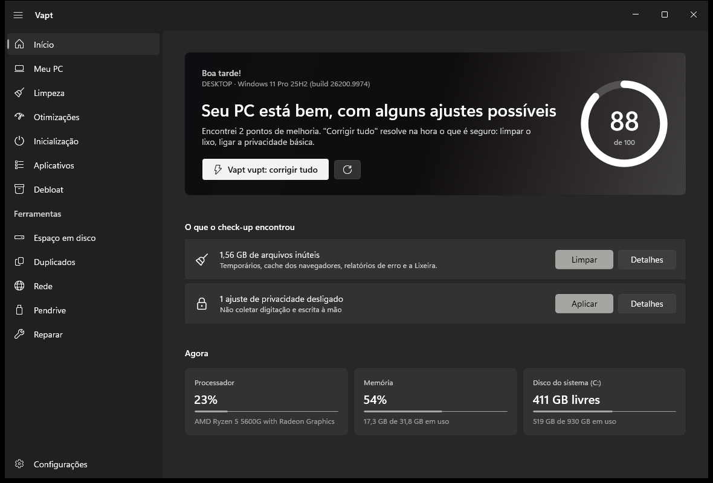
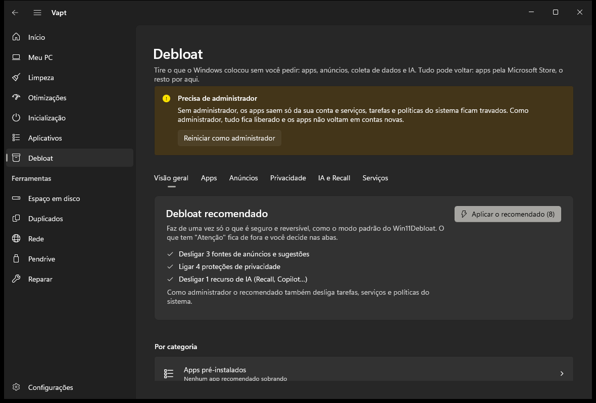
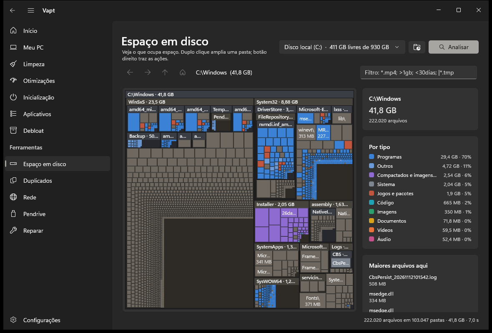
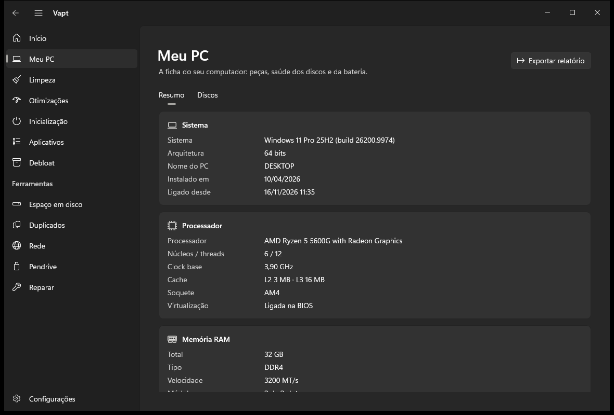
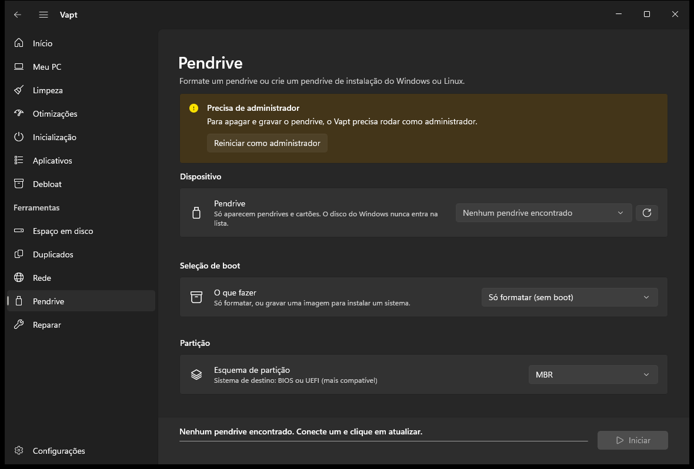

<div align="center">


# Vapt

**Deixe o Windows rápido como um vapt vupt.**
Limpeza, debloat, Recall, mapa do disco, pendrive de boot e reparo num app só, com a cara do próprio Windows.

[](https://github.com/blat0r/Vapt/releases/latest/download/Vapt.App-win-Setup.exe)

[](https://github.com/blat0r/Vapt/releases/latest)
[](https://github.com/blat0r/Vapt/releases)

[](LICENSE)



</div>

## Por que o Vapt

- **Diz o que fazer.** O Check-up dá uma nota de 0 a 100 para o PC e lista cada problema com um botão de corrigir.
- **Tudo volta atrás.** Antes de mudar qualquer coisa, o Vapt guarda o valor original. "Desfazer tudo" devolve o Windows exatamente como estava, e ainda há ponto de restauração.
- **Só o que funciona.** Nada de "limpar registro", "liberar RAM" a toda hora ou desligar o Defender: isso não deixa o PC mais rápido e às vezes estraga. Cada ajuste foi conferido no Windows 11 24H2/25H2 e no Windows 10 22H2.
- **Leve e nativo.** WinUI 3 com Mica (acrílico no Windows 10), abre em menos de um segundo e não fica rodando em segundo plano.
- **Atualiza sozinho.** Cada versão nova publicada aqui chega no seu Vapt automaticamente.

## O que tem

<table>
<tr>
<td width="50%"></td>
<td width="50%"></td>
</tr>
<tr>
<td><b>Debloat</b> · apps pré-instalados, anúncios, privacidade, <b>IA e Recall</b> (o recurso que fotografa a tela a cada poucos segundos) e serviços, com um "Debloat recomendado" de um clique.</td>
<td><b>Espaço em disco</b> · mapa em blocos estilo SpaceSniffer que aparece na hora e cresce durante a análise. Meio milhão de arquivos em segundos, sem administrador.</td>
</tr>
<tr>
<td></td>
<td></td>
</tr>
<tr>
<td><b>Meu PC</b> · ficha completa (CPU, RAM por módulo, GPU, placa-mãe), <b>saúde dos discos</b> (S.M.A.R.T.), bateria, teste de velocidade do disco e relatório para mandar ao técnico.</td>
<td><b>Pendrive</b> · formata como o Rufus (inclusive FAT32 acima de 32 GB) e cria pendrive do Windows 11 sem TPM ou de Linux.</td>
</tr>
</table>

| Página | O que faz |
|---|---|
| **Início** | Check-up com nota e "Vapt vupt: corrigir tudo"; CPU, RAM e disco ao vivo. |
| **Meu PC** | Sistema, placa-mãe/BIOS, processador, RAM por módulo (avisa quando o XMP está desligado), placa de vídeo, saúde dos discos, bateria (desgaste e ciclos), teste de disco e relatório HTML. |
| **Limpeza** | Temporários, cache dos navegadores (senhas e cookies ficam), Lixeira, Windows Update, relatórios de erro, WinSxS pelo DISM. |
| **Otimizações** | Interface, sistema e jogos, cada uma com desfazer. **Turbo para jogar** fecha OneDrive, Teams, Widgets e afins antes do jogo. **Cache da memória** limpa a lista standby quando a RAM livre acaba (para PC com pouca RAM que engasga em jogo) e diz quando não precisa. |
| **Inicialização** | Liga/desliga o que abre com o Windows (igual ao Gerenciador de Tarefas), com "Restaurar removidos". |
| **Aplicativos** | Desinstala **sem deixar rastro** (procura as sobras como o Revo), vários de uma vez, entradas quebradas, **atualizações** pelo winget e **instalar os essenciais** depois de formatar. |
| **Debloat** | Apps, anúncios, privacidade, IA e Recall, serviços e tarefas de coleta de dados. |
| **Espaço em disco** | Mapa do disco com filtro (`*.mp4; >1gb; <30dias`), maiores arquivos e excluir para a Lixeira. |
| **Duplicados** | Arquivos idênticos pelo conteúdo; mantém a original e manda as cópias para a Lixeira. |
| **Rede** | Teste de lag: ping, oscilação e perda até o roteador e a internet, DNS, velocidade e ping com a linha cheia. Diz se o problema é o Wi-Fi ou o provedor. |
| **Pendrive** | Formatar e criar pendrive de boot (Windows ou Linux), com verificação. |
| **Reparar** | SFC, DISM, cache de ícones, rede, DNS (Cloudflare, Google, Quad9, AdGuard) e plano de energia. |
| **Desempenho → Sensores** | Temperatura, clock, uso, consumo, ventoinhas e voltagens de cada peça, ao vivo, com mínimo e máximo. |
| **Desempenho → Overlay de FPS** | FPS, tempo de quadro, 1% low, GPU e CPU por cima do jogo (Ctrl+Shift+O). Mede pelo Windows, sem injetar nada. |
| **Desempenho → Benchmark** | Processador (ray tracing, multi e single-core) e placa de vídeo (cena 3D em Direct3D 11), com histórico. |
| **Desempenho → Stress test** | CPU e GPU no máximo com limite de temperatura, gráfico ao vivo e checagem de erros de hardware. |
| **Desempenho → Overclock** | NVIDIA: limite de energia e faixa de clock (undervolt fácil), com restaurar. Guia de BIOS para CPU e RAM. |

## Instalar

1. Baixe o **[Vapt.App-win-Setup.exe](https://github.com/blat0r/Vapt/releases/latest/download/Vapt.App-win-Setup.exe)** e abra.
2. Pronto: ele instala para a sua conta, cria o atalho e abre. Não precisa instalar .NET nem nada antes.

Outras opções na [página de versões](https://github.com/blat0r/Vapt/releases/latest): `.msi` (para todos os usuários do PC) e `Portable.zip` (sem instalar).

> O instalador ainda não é assinado digitalmente. Se aparecer "O Windows protegeu o computador", clique em **Mais informações → Executar assim mesmo**.

## Perguntas

**Precisa de administrador?** Não para abrir. Limpeza da sua conta, mapa do disco, duplicados e a maior parte do debloat funcionam direto. Para mexer no sistema (serviços, Windows Update, pendrive), as páginas mostram **Reiniciar como administrador**. Em Configurações dá para mandar abrir sempre como administrador.

**E se algo der errado?** Cada otimização guarda o valor original em `%LOCALAPPDATA%\Vapt\backup.json`; **Desfazer tudo** volta ao que era. Antes da primeira mudança de sistema o Vapt cria um ponto de restauração. Apps removidos voltam pela Microsoft Store; chaves de registro apagadas ganham um `.reg` de backup.

**Funciona no Windows 10?** Sim, no Windows 10 2004 ou mais novo. O que só existe no 11 (Recall, menu de contexto novo, Widgets) não aparece lá.

**Coleta dados?** Não. O Vapt só fala com a internet para procurar atualizações aqui no GitHub e, quando você pede, para o teste de velocidade (speed.cloudflare.com) e o winget.

## Para desenvolvedores

Requer o .NET 10 SDK. Interface em WinUI 3 (Windows App SDK 2.6), mapa do disco em Win2D, instalador e atualização com [Velopack](https://velopack.io).

```powershell
dotnet build Vapt.slnx                     # compila (sempre a solução, não só o projeto)
dotnet test tests\Vapt.Core.Tests          # testes
.\scripts\run.ps1 -- --page disk           # compila e abre numa página
.\scripts\pack.ps1                         # instalador em artifacts\releases
```

Argumentos: `--page <home|system|cleanup|tweaks|startup|apps|debloat|disk|duplicates|network|usb|repair|sensors|bench|stress|oc|overlay|settings>`, `--scan <pasta>`, `--dupes <pasta>`, `--tab <n>` (Debloat), `--overlay` (liga o overlay), `--smoke` (monta todas as páginas e sai). Teste do renderizador 3D (abre uma janela): `$env:VAPT_GPU_TEST=1; dotnet test`.

**Publicar uma versão:** mude o `<Version>` em `Directory.Build.props`, escreva as novidades em `docs/notas/vX.Y.Z.md` e crie a tag. O GitHub Actions ([publicar.yml](.github/workflows/publicar.yml)) testa, gera o instalador com atualização delta e publica a Release; o Vapt de todo mundo atualiza sozinho.

```powershell
git tag v1.2.0
git push origin v1.2.0
```

<details>
<summary>Detalhes técnicos</summary>

- **Varredura do disco** (`Core/Disk/DiskScanner.cs`): `FindFirstFileExW` com `FindExInfoBasic` + `FIND_FIRST_EX_LARGE_FETCH`, uma thread por núcleo, cada pasta publicada de uma vez para a interface ler enquanto a varredura escreve. Não segue junções; arquivos só na nuvem contam 0.
- **Mapa** (`Controls/TreemapView.cs`): treemap *squarified* em Win2D, desenhado num bitmap em cache; o hover só redesenha o contorno.
- **FAT32 acima de 32 GB** (`Core/Usb/Fat32Formatter.cs`): formatador próprio pela especificação da Microsoft (fatgen103), escrito no volume travado.
- **Pendrive seguro**: só lista USB/SD/MMC que não são de boot nem de sistema; antes de apagar, confere `UniqueId` + tamanho de novo. Gravação Raw com o disco offline.
- **Sobras de programas** (`Core/Apps/Leftovers.cs`): só lugares conhecidos e nomes que batem com o programa; nunca a pasta de outro programa instalado.
- **Saúde dos discos**: `MSFT_PhysicalDisk` e `MSFT_StorageReliabilityCounter` (Windows Storage).
- **Teste de disco**: arquivo temporário com `FILE_FLAG_NO_BUFFERING`, sequencial 1 MB e aleatório 4K com fila 1 e 32.
- **Dados** em `%LOCALAPPDATA%\Vapt` (`settings.json`, `backup.json`, `reg-backups\`, `logs\`), que ficam ao desinstalar para dar para desfazer depois.

</details>

## Créditos

- Lista de apps do Debloat: [Win11Debloat](https://github.com/Raphire/Win11Debloat) (MIT).
- Sensores pelo [LibreHardwareMonitor](https://github.com/LibreHardwareMonitor/LibreHardwareMonitor) (MPL-2.0); FPS pelo [TraceEvent](https://github.com/microsoft/perfview) (MIT); 3D pelo [Vortice](https://github.com/amerkoleci/Vortice.Windows) (MIT).
- Ajustes conferidos com o [WinUtil](https://github.com/ChrisTitusTech/winutil) e o [privacy.sexy](https://github.com/undergroundwires/privacy.sexy).
- A pesquisa por trás das escolhas está em [reports/](reports/Otimizadores%20de%20PC%20para%20o%20Vapt.md). Avisos completos em [NOTICE.md](NOTICE.md).

## Licença

[GPL-3.0-or-later](LICENSE) © 2026 **blat0r**.
